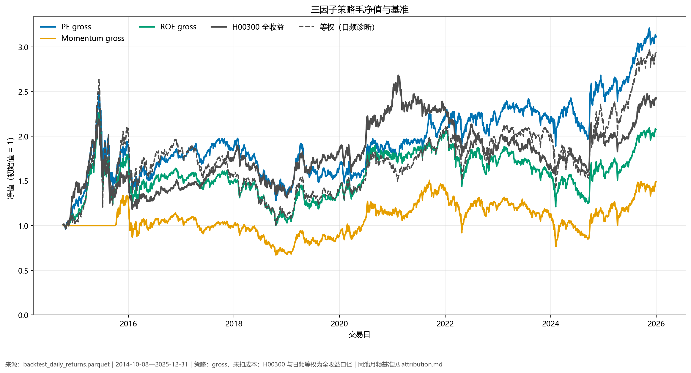
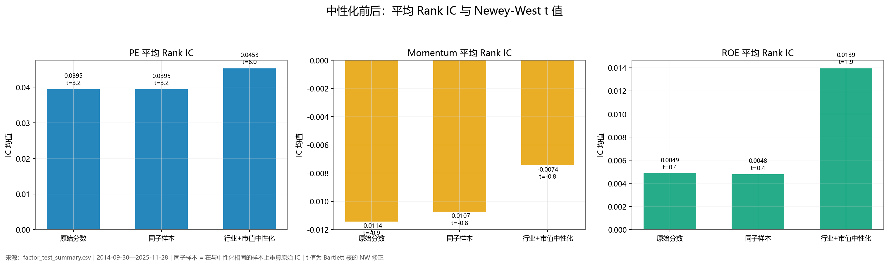

# A 股单因子研究：PE、Momentum、ROE

[](https://github.com/IvyRockwell/a-share-single-factor-backtest/actions/workflows/tests.yml)

用 CSMAR A 股数据检验价值（PE）、动量（Momentum）、质量（ROE）三个基础因子的选股能力，并把横截面结论落到一个按开盘成交、计入佣金与印花税、等权月度调仓的回测上。样本 2014-09-12 至 2025-12-31，136 个月末信号日，2,735 个交易日。

**研究结论见 [`reports/research_note.md`](reports/research_note.md)。**

## 主要结果

| 因子 | 平均 Rank IC | IC 胜率 | 累计 Q5-Q1 | Top 20% 毛累计 | 年化 | 最大回撤 | Sharpe |
| --- | ---: | ---: | ---: | ---: | ---: | ---: | ---: |
| PE | 0.0395 | 62.96% | 34.19% | 211.44% | 11.03% | -48.22% | 0.572 |
| Momentum（12-1） | -0.0114 | 46.34% | -1.30% | 49.09% | 3.75% | -49.85% | 0.274 |
| ROE | 0.0049 | 49.63% | -47.20% | 107.44% | 6.95% | -55.64% | 0.400 |
| H00300 | — | — | — | 141.94% | 8.48% | -46.06% | 0.483 |
| 等权股票池（日频诊断） | — | — | — | 193.90% | 10.44% | -61.91% | 0.486 |
| 市值加权股票池（日频诊断） | — | — | — | 143.30% | 8.54% | -48.43% | 0.476 |

上表策略与基准均为日频口径，且已加入开盘涨跌停拒单、ADV 容量上限（**固定按初始资金 1 亿元计算，不随 NAV 复利**；5% ADV）、每笔最低 5 元佣金和退市核销；同池月频口径见下。三个主因子中，只有 PE 的 IC 显著且 Q5-Q1 月均方向为正；原始纯多头相对同池月频等权的 alpha 不显著。中性化 PE 也只在 gross、相对同池等权时 t=2.20；扣 20bp 后 t=1.77，换成 H00300 后 t=1.35，均不显著（见下）。Momentum 12-1 的累计 Q5-Q1 为负且月均约 0、没有单调关系；6-1 更负，1M 反转反而显著。ROE 的横截面区分度接近零。加入 20 bp 滑点后三者净累计收益分别为 186.03%、21.75%、95.39%。

未来收益已改为**下一交易日开盘买入口径**：首个持有日按 `close_price / open_price - 1` 计，其后按 `Dretwd` 复利到下一信号日收盘；首日开盘或收盘无效的记录不进入 IC。持仓期内“终止上市”的股票按配置的 -100% 核销（26 次），0% 与 -100% 两条边界的净值影响不超过 3.2 个百分点，详见研究笔记 5.6。

**超额里有多少是因子？** 旧口径的 10.44% 是**日频再平衡**等权基准；同股票池、同开盘执行、月频再平衡并加入涨跌停拒单的等权基准只有 **8.38%**，与日频差约 2.1 个百分点。因此“相对 HS300 的 3.04pp 里 1.96pp 是等权、1.08pp 是因子”的几何减法不再使用。

| 月频口径 | 年化 | 年化波动 | Sharpe | 最大回撤 |
| --- | ---: | ---: | ---: | ---: |
| PE gross | 10.63% | 21.89% | 0.571 | -35.28% |
| 同池月频等权 | 8.38% | 28.48% | 0.423 | -54.03% |
| 同池月频市值加权 | 6.79% | 21.96% | 0.408 | -43.02% |
| H00300 | 8.17% | 21.76% | 0.468 | -39.78% |

对 PE gross 做月度回归：相对同池月频等权的 alpha 为 **4.55%/年（t 1.36，beta 0.667）**，月均超额 **+0.04%（NW t 0.13）**；两因子（HS300 + 等权价差）alpha **2.69%/年（t 1.10）**，20bp 滑点后 **1.91%/年（t 0.79）**。回归 alpha 主要来自低 beta，原始纯多头统计上不显著。对行业与市值做中性化后，PE 的 IC 从 0.0395 **升到 0.0453**，ICIR 从 0.24 **升到 0.48**；把中性化分数真正接进多头回测后，**PE gross 年化 13.30%，相对同池月频等权 gross alpha 5.48%/年（t 2.20）**。但 net20 年化 12.07%、alpha 4.38%/年（t 1.77），换成 H00300 后 gross alpha 6.77%/年（t 1.35）、net20 5.65%/年（t 1.14），**均不显著**。最大回撤 -50.71%，且仍是样本内；因此准确说法是“gross、同池等权口径下显著”，不是稳健的可交易 alpha。





## 价值因子的四种写法与时间切分

`pespecs` 与 `validate` 两步回答“结论换一种写法、换一段样本还在不在”。**IC 稳健，纯多头超额不稳健**——这是本次最重要的新结论。

| PE 写法 | 平均 Rank IC | IC t（NW） | Q5-Q1 月均 | Q5-Q1 t（NW） | 同池纯多头 alpha（t） |
| --- | ---: | ---: | ---: | ---: | ---: |
| `pe`：正盈利 PE | 0.0395 | 3.17 | 0.253% | 0.66 | 4.55%（1.36） |
| `ep_all`：含负盈利 E/P | 0.0359 | 2.97 | 0.061% | 0.16 | 4.55%（1.45） |
| `bm`：B/M（最新已披露年报） | **0.0562** | **4.15** | **0.762%** | 1.90 | 5.91%（1.71） |
| `pe_12m`：上市满 12 个月后重排 | 0.0394 | 3.17 | 0.256% | 0.67 | 不做（基准应换池） |

- 12 个月上市门槛几乎不影响 PE（IC 0.0394 vs 0.0395，平均可排名 2,772 vs 2,775）；B/M 的横截面信号最强；含负盈利的 E/P 保住了 IC，但 Q5-Q1 从 0.253% 掉到 0.061%。
- 多重检验按六个**独立族**分开：`main_long_only`（三主因子 gross 月均超额）Holm 后无一显著（0.750–0.895）；`momentum_variants_ic` 与 `momentum_variants_long_short` 里 **1M 反转**分别通过 Holm（3.4e-6、0.0080），12-1/6-1 不显著；`neutral_long_only` 的三个**月均 net20 超额**无一显著（PE Holm 0.5565）；`pe_specs_ic` 四个写法全部通过 Holm（0.0002–0.0057）；`pe_specs_long_short` 最强 `bm` 的 Holm 0.2406，**仍不显著**。
- **固定 holdout**：只用开发期（2014-10 至 2019-12）按 IC t 选一个因子 → 选中 PE；测试期（2020-01 至 2025-12）PE 的 Rank IC 仍为 0.0338（NW t 2.07），但纯多头 alpha 只有 3.84%/年（t 0.93）、20bp 后 3.09%（t 0.75），**不显著**。
- **年度 walk-forward**：2018–2025 每年用此前 ≥24 个月 IC 选因子，PE 每年都被选中；链式 OOS 累计 67.22%（年化 6.64%、Sharpe 0.435、最大回撤 -29.85%），同期同池等权 72.87%，**相对等权 -5.65%**。
- **四个子区间是事后按风格划分的**，只用于描述，不是样本外证据；holdout 只是“因子选择”的样本外，walk-forward 只是“因子轮动选择”的样本外，候选集合、因子定义、股票池与执行规则仍是全样本设计的。

## 数据

CSMAR（国泰安）。原始导出需自行获取，放入项目根目录的 `项目初始数据/`，**不随仓库分发**——CSMAR 数据受其最终用户许可协议约束，版权归深圳希施玛数据科技有限公司。

| 表 | 用途 |
| --- | --- |
| `TRD_Dalyr` | 个股日行情（收益、复权收盘价、交易状态） |
| `STK_MKT_ValuationMetrics` | 估值指标（`PE1TTM`） |
| `FS_Comins` / `FS_Combas` / `IAR_Forecdt` | 利润表、资产负债表、实际披露日 |
| `TRD_Co` / `STK_LISTEDCOINFOANL` / `STK_ITEMCHANGE` | 上市日、上市状态变更（含终止上市） |
| `STK_CAPITAL` | 股本变动（总股数、流通股数） |
| `STK_INDUSTRYCLASS` | 行业分类（证监会 2012 版） |
| `TRD_Cale` | 交易日历 |
| `IDX_Idxtrd` | 沪深 300 全收益（H00300） |

## 方法要点

- **股票池**：月末最后一个交易日构建，要求当日正常交易、上市满 6 个自然月、未处于暂停上市 / 退市整理 / 终止上市。状态按事件生效日判断，后来退市的股票在退市前仍留在池中，避免幸存者偏差。
- **因子**：PE 用按实际披露日重建的 TTM 净利润 ÷ 总市值，为正者反向排名（供应商 `PE1TTM` 只留作对照，实测含前视）；Momentum 主因子为 12-1（前 12 个月到前 1 个月），并列 6-1 与 1M 反转；ROE 只取信号日前已实际披露的合并年报。
- **PE 前视诊断**：股票-月份级比较重建 PE 与供应商 PE，供应商可用而重建不可用、或相对差 ≥ 1% 即标记；剔除被标记股票-月份的“干净子样本”上重算 IC，整月 50% 阈值只作月度汇总。
- **中性化**：每个信号日对 `log(市值)` 与证监会行业哑变量做 OLS，取残差重新排名；样本不足时自动降级为纯市值。
- **基准**：H00300，加上同股票池的日频等权/市值加权诊断；`attribute` 步骤再构造同池月频、同开盘执行的等权/市值加权基准并做回归 alpha。
- **PE 的四种写法**：`pespecs` 同时检验正盈利 PE、含负盈利的 E/P、B/M（最新已披露年报权益 ÷ 市值）与「上市满 12 个自然月后重排」的 PE；前三者共用主股票池，跑同一套纯多头并相对同池月频等权做 alpha，12 个月版本只做因子检验以避免基准错配。
- **检验**：五分位分组、下一交易日开盘买入到下月信号日收盘的收益、Spearman Rank IC、Q5-Q1；t 值用 Newey-West 修正，并按四个风格阶段给出子区间稳定性。
- **时间切分与多重检验**：`validation` 输出子区间组合超额（事后风格划分，仅描述）、固定 holdout（2014-10 至 2019-12 开发、2020 起测试，只按开发期 IC t 选一个因子）、2018 起年度 walk-forward（每年用此前 IC 选因子、持有下一年），以及分族的 Holm / Benjamini-Hochberg / White Reality Check（max-mean，stationary bootstrap）。
- **组合**：Top 20% 等权、月度调仓、下一交易日开盘执行；先退出与减仓，再新建与加仓，现金不足时按比例缩减。单票目标权重受信号日 20 日 ADV × 5% ÷ **初始资金 1 亿元**约束，超出部分留现金；该容量上限固定按初始资金计算，**不随组合净值增长而复利放大**；开盘涨停的买入、开盘跌停的卖出拒单。
- **退市核销**：持仓期或待卖队列中的股票“终止上市”后，在事件生效后的首个交易日照 `delisting.return_assumption`（默认 -100%）核销，不再冻结在待卖队列，也不产生交易成本。CSMAR 不区分吸收合并与真正退市，0% 与 -100% 是两条边界情景。
- **成本**：佣金双边 3 bp、每笔最低 5 元（初始资金 1 亿元），印花税卖出 10 bp（2023-08-28 起 5 bp），滑点 0 / 10 / 20 bp 三档情景，并计算盈亏平衡滑点。

## 目录

```text
configs/config.yaml     全部参数与研究假设
src/data_loader.py      原始 CSV → 标准化 parquet，附质量标记
src/universe.py         历史股票池（point-in-time）
src/market_cap.py       总股本 × 收盘价，逐月市值
src/factors.py          PE / Momentum 12-1 + 6-1/1M 变体 / ROE + 中性化 + 股票-月份 PE 前视标记
src/factor_test.py      分组、开盘起算未来收益、Rank IC 与 t 值、干净子样本 IC
src/momentum_variants.py 12-1 / 6-1 / 1M 反转并列检验
src/portfolio.py        目标组合、ADV 容量与调仓动作
src/trading_rules.py    涨跌停限价与开盘可交易判断
src/backtest.py         开盘成交、等权恢复、现金约束、退市核销的逐日账本
src/delisting.py        终止上市事件表与持有期回报调整
src/costs.py            佣金/最低佣金、印花税、滑点、盈亏平衡
src/performance.py      收益、波动、回撤、Sharpe，三条基准
src/attribution.py      同池月频基准、回归 alpha、Q5-Q1、中性化多头
src/pe_specs.py         PE specification robustness：正盈利 PE、含负盈利 E/P、B/M、12 个月上市门槛
src/validation.py       子区间组合超额、固定 holdout、年度 walk-forward、多重检验
src/robustness.py       参数与成本网格
src/visualization.py    研究图表
reports/research_note.md   研究笔记（定稿）
reports/figures/           18 张图
notebooks/01_data_exploration.ipynb  原始数据探查
tests/                     148 个用例（构造数据，不依赖原始数据）
run.py                     命令行入口
```

## 运行

```bash
python -m venv .venv && source .venv/bin/activate   # Windows: .venv\Scripts\activate
pip install -r requirements.txt

python run.py clean universe marketcap factors evaluate momvariants portfolio backtest costs performance attribute pespecs validation robustness figures
python run.py all          # 等价于按上面的顺序全部执行
python -m pytest -q        # 不需要原始数据
```

步骤名是 `validate`，命令里也接受别名 `validation`（产物与报告都用 validation 命名）。`run.py` 只按固定顺序执行，`pespecs` 在 `attribute` 之后、`validate` 在 `pespecs` 之后、`robustness` 之前。

`factors` 同时写出 `data/processed/pe_pit_stock_month.csv`（494,788 个股票-月份的 PE 前视标记）与月度汇总 `pe_pit_check.csv`；`evaluate` 写出 `pe_source_comparison.csv`（全样本与干净子样本的 IC）；`backtest` 写出 `backtest_delisting_events.csv` 与 `backtest_delisting_impact.csv`（0%/-50%/-100% 三档核销情景的精确重跑）。`momvariants` 生成 12-1 / 6-1 / 1M 反转的并列 IC/Q5-Q1；`attribute` 生成同股票池月频基准、回归 alpha、Q5-Q1 多空、中性化纯多头与多头桥，写入 `reports/generated/attribution.md`；图 05 仍画日频诊断基准，月频归因以该表为准。

各步骤把审计报告写入 `reports/generated/`（不纳入版本控制），`reports/research_note.md` 与 `reports/figures/` 为定稿产物。图表中文标签使用 Microsoft YaHei / SimHei，在 macOS 或 Linux 上重跑 `figures` 需要改 `src/visualization.py` 中的 `font.sans-serif`。

`pespecs` 生成四个 PE 写法的 IC / 分位 / 摘要（`pe_specs_ic.csv`、`pe_specs_quantiles.csv`、`pe_specs_summary.csv`）以及前三个写法的同股票池纯多头 alpha（`pe_specs_portfolio.csv`），报告见 `reports/generated/pe-specs.md`。`validate` 生成 `validation_subperiod_portfolio.csv`、`validation_holdout.csv`、`validation_walkforward.csv`、`validation_multiple_testing.csv`，报告见 `reports/generated/validation.md`；它只读取前面步骤的月度收益与 IC 序列，不重新回测。`attribute` 额外写出 `attribution_neutral_monthly_returns.csv`，供 `validate` 的 `neutral_long_only` 族使用。

## 口径与已知限制

- 未来收益从**下一交易日开盘**买入起算：首个持有日 `close/open`，其后 `Dretwd` 复利到下一信号日收盘；首日开盘或收盘无效的记录不进入 IC 与分组。因此 IC 与分位累计收益整体低于旧的收盘起算口径。
- PE 由披露日重建，供应商 `PE1TTM` 实测含前视：季度末净利润在披露前就被用于计算，已披露月份两者逐位一致。股票-月份级标记显示 494,788 个股票-月份中 154,183 个（31.16%）有前视迹象；剔除后供应商 IC 从 0.0495 降到 0.0467（见研究笔记 5.3）。
- 持仓期内“终止上市”的股票按统一假设核销（默认 -100%）。CSMAR 不区分吸收合并与真正退市，0% 是合并对价的乐观边界，-100% 是保守边界；样本内 26 次核销，两条边界的净值影响不超过 3.2 个百分点。
- 中性化用"总股本 × 收盘价"的市值，未做自由流通市值调整；行业为证监会 2012 版大类，按实施日逐月对齐。
- 信号日按 `Trdsta=1` 已排除 ST/*ST，但持仓期内转为 ST 或长期停牌的不做单独处理，只在无法交易时冻结估值；次新股门槛 6 个自然月；|日收益| > 100% 的记录保留不 winsorize。
- 已建模开盘涨跌停拒单、**固定 1 亿元初始资金下的** ADV 容量上限、每笔最低 5 元佣金和盈亏平衡滑点；仍**未**建模开盘未封板但盘中被封、一字板打开后的成交、整手/最小报价单位、盘口深度与逐笔冲击。现金收益为 0。
- **容量口径**：ADV 上限固定按初始资金 1 亿元计算，不是随组合净值增长的复利 AUM。PE 期末净值约 3.1 倍，后期实际 AUM 约 3.1 亿元，5% ADV 的实际约束会比回测显示的更紧。因此 211.44% 累计收益应理解为“固定 1 亿元 AUM 容量约束下”的结果，不能直接外推为 3 亿元复利 AUM 下可实现的业绩。
- Momentum 12-1 的前 12 个月没有 12 个月历史，样本从 2015 年下半年起；1M 反转虽然 IC 最强，但未进入主组合，其换手/容量约束更紧。
- 同池月频基准按执行日开盘买入、下一执行日开盘估值，标签取起始月；策略月度按自然月，月末/月初边界有一天的已知错位。基准不计成本；旧日频等权/市值加权只作诊断。
- Q5-Q1 是统计多空组合，A 股融券受限，不可直接交易；20bp 列是按成员换手估算的成本敏感性，不是可交易回测。
- IC 与多空 t 值已按 Newey-West 修正，但四个子区间是**事后按风格划分**的，只用于描述收益如何随风格变化，不是样本外证据；4.3 的 IC 子区间表同样不能当作稳定性证明。
- 固定 holdout 只把 2020 年之后的样本用在「三选一」这一步，是**因子选择**的样本外，不是完整研究问题的样本外：候选集合、因子定义、股票池与执行规则仍是全样本设计的。
- 年度 walk-forward 是**因子轮动选择**的样本外，只有 3 个候选因子、8 个年度决策，没有做参数优化，统计功效有限。
- 多重检验按六个**独立族**分开做 Holm / Benjamini-Hochberg / White Reality Check：`main_long_only`（三主因子 gross 超额）、`momentum_variants_ic` / `momentum_variants_long_short`（12-1 / 6-1 / 1M）、`neutral_long_only`（中性化纯多头的月均 net20 超额）、`pe_specs_ic` / `pe_specs_long_short`（四个 PE 写法）。每个族只检验一个指标，IC 与收益价差、gross 与 net20 不混族；RC 是 **max-mean** 统计量而不是 max-Sharpe，只作保守参考，不替代 t 检验。若某因子 raw t 显著但校正后不显著，结论按「多重检验后不显著」表述。
- Sharpe 按 252 个交易日年化、无风险利率取 0，分子为日算术均值，表中年化收益为几何复利，两者口径不同；归因表的月频年化按 12/135 折算。
- 历史回测不能证明因果关系，也不代表未来收益。

## 许可

代码与文档 MIT；CSMAR 数据不在许可范围内。本项目仅用于研究，不构成投资建议。
