# A 股 PE、Momentum 与 ROE 单因子研究报告

## 研究结论摘要

本样本内，PE 提供了三项相互一致的选股证据：平均 Rank IC 为 0.0501，IC 胜率为 65.93%，累计 Q5-Q1 为 76.70%。以 PE 分数最高的约 20% 股票构建月度等权组合后，策略毛累计收益为 286.89%，高于 H00300 全收益指数的 141.94%。加入成本后，PE 在 20 bp 滑点情景下的净累计收益为 255.64%。这些结果受 PE 数据可用时点假设限制，不能视为严格无前视偏差的结论。

Momentum 的因子检验方向与预设方向相反：平均 Rank IC 为 -0.0236，累计 Q5-Q1 为 -74.23%。基准策略仍取得 25.76% 毛累计收益，但换手率较高，使其对成本更敏感；20 bp 情景下净累计收益降至 -11.77%。稳健性网格中，Momentum 的净累计收益在 -16.37% 至 27.66% 之间，收益方向会随参数和成本改变。

ROE 的平均 Rank IC 为 0.0065，接近零，累计 Q5-Q1 为 -43.26%。ROE 策略取得 117.99% 毛累计收益，但低于 H00300，且因子检验没有呈现清晰的排序关系。正的策略绝对收益可能同时受到市场整体上涨和组合暴露影响，不能替代横截面选股能力的证据。

回测只描述 2014—2025 年样本。它不证明因果关系，也不保证未来收益。涨跌停、最低佣金、盘口滑点和真实订单成交能力等因素未被完整模拟。

## 数据与研究范围

数据来自 CSMAR。正式数据范围为 2014-09-12 至 2025-12-31。月末历史股票池共有 136 个信号日，范围为 2014-09-30 至 2025-12-31；实际回测统一使用 2014-10-08 至 2025-12-31 的 2,735 个交易日。

股票池覆盖沪深 A 股、创业板和科创板，不含 B 股和北交所。股票在信号日需要上市满 6 个自然月、当日正常交易，且未处于暂停上市、退市整理或终止上市状态。筛选使用当时已生效的信息，不用研究期末的存活名单反推历史。每期股票池有 2,060 至 4,938 只，平均 3,638.1 只。

三个因子分别使用自身可排名样本，不强制取共同样本。PE、Momentum、ROE 的平均可排名股票数分别为 2,981.9、3,535.1 和 3,593.9。Momentum 在最早 6 个信号期没有完整的六个月价格历史，因此不填造因子结果。

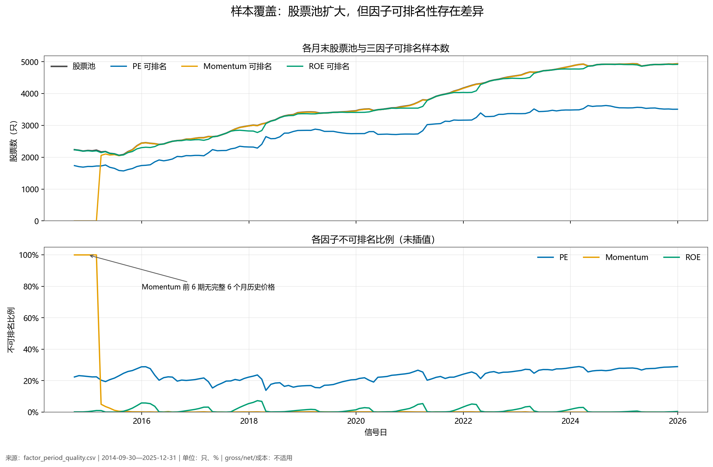

## 因子定义与检验方法

- **PE**：使用信号日的正值 `PE1TTM`。PE 越低，分数越高。缺失和非正值不参与排名，正值极端值不截尾。
- **Momentum**：使用含现金红利再投资的调整收盘价，计算不跳过最近一个月的过去 6 个自然月收益。收益越高，分数越高。
- **ROE**：使用信号日前严格已披露的最新合并年度报告，以净利润除以期末股东权益。权益必须为正，净利润允许为负；ROE 越高，分数越高。

阶段 5 检验的是因子分数能否区分下一持有期收益，不是开盘可成交策略。每个信号日将股票分为五组，Q1 是最低分组，Q5 是最高分组；边界同分股票保留在同组。未来收益从下一交易日开始，计算到下一个月末信号日收盘。

Rank IC 是因子排名与下一期股票收益排名的 Spearman 相关系数。正值表示实际收益排序与因子设定方向较一致；IC 胜率是有效月份中 Rank IC 大于零的比例。Q5-Q1 是每期最高组收益减最低组收益，表中的累计值按期相加，并非可直接投资的复利净值。

| 因子 | Q1 累计收益 | Q2 | Q3 | Q4 | Q5 累计收益 | 累计 Q5-Q1 | 平均 Rank IC | IC 胜率 | 有效 IC 期数 |
| --- | ---: | ---: | ---: | ---: | ---: | ---: | ---: | ---: | ---: |
| PE | 41.84% | 122.56% | 213.48% | 300.69% | 293.65% | 76.70% | 0.0501 | 65.93% | 135 |
| Momentum | 149.40% | 105.84% | 103.31% | 52.63% | 16.41% | -74.23% | -0.0236 | 39.53% | 129 |
| ROE | 188.56% | 197.16% | 160.01% | 183.28% | 117.47% | -43.26% | 0.0065 | 48.89% | 135 |

PE 的高分组整体高于 Q1，但 Q5 并非每次或最终都高于 Q4，因此不能写成严格单调关系。Momentum 的高分组表现更弱，ROE 各组也没有形成清晰的递增排序。

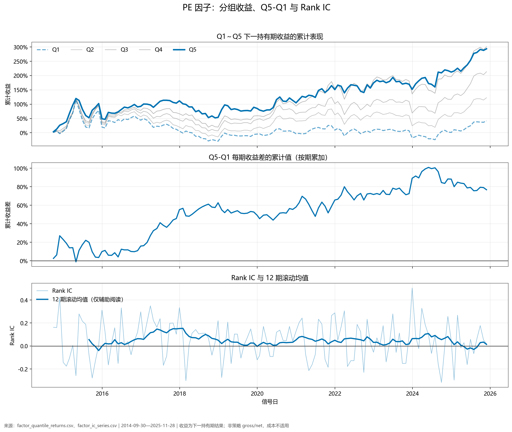

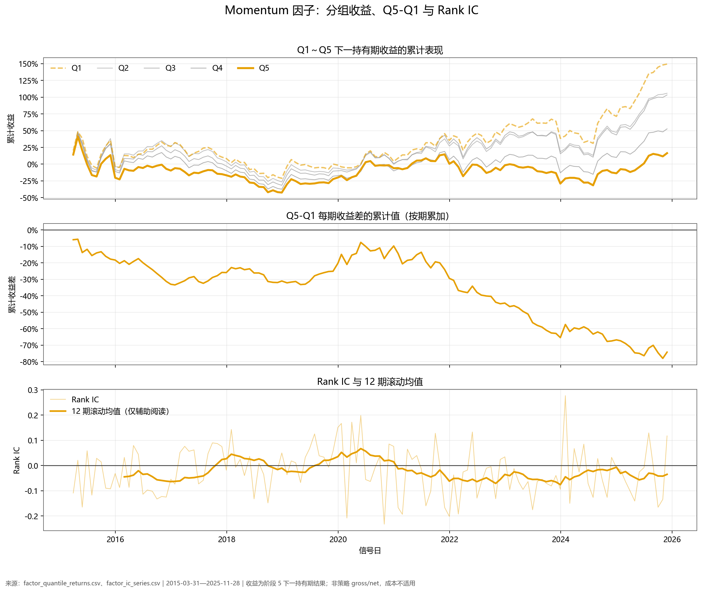

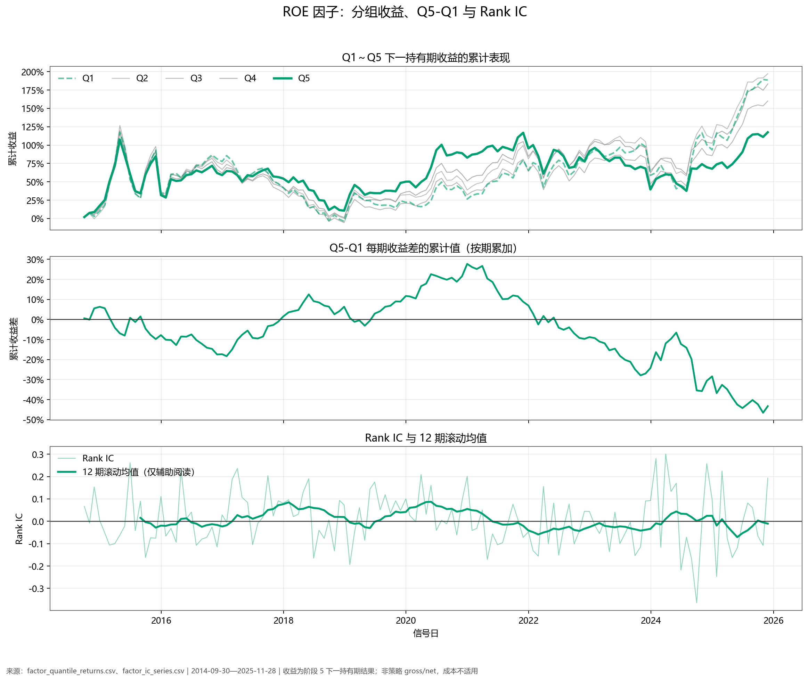

阶段 5 现在每个因子和信号日只计算一次 Q5-Q1；`cumulative_q_high_minus_q_low` 在同期五个分位行中完全一致，并与逐期 Q5-Q1 直接累加一致。

## 策略回测结果

三个基准策略均在月末形成信号，选择分数最高的约 20% 股票并等权配置，边界同分全部保留。组合在下一交易日开盘执行；无法买入的权重留作现金，无法卖出的持仓在恢复正常交易且开盘价有效后再卖出。

gross 是未扣交易成本的毛收益，net 是扣除佣金、印花税和对应滑点后的净收益。H00300 使用 CSMAR 的全收益指数日收益，包含分红再投资。

最大回撤表示净值从历史高点到随后低点的最大跌幅。Sharpe Ratio 用单位波动对应的平均超额收益衡量风险收益，本研究按年化无风险利率 0% 和每年 252 个交易日计算。

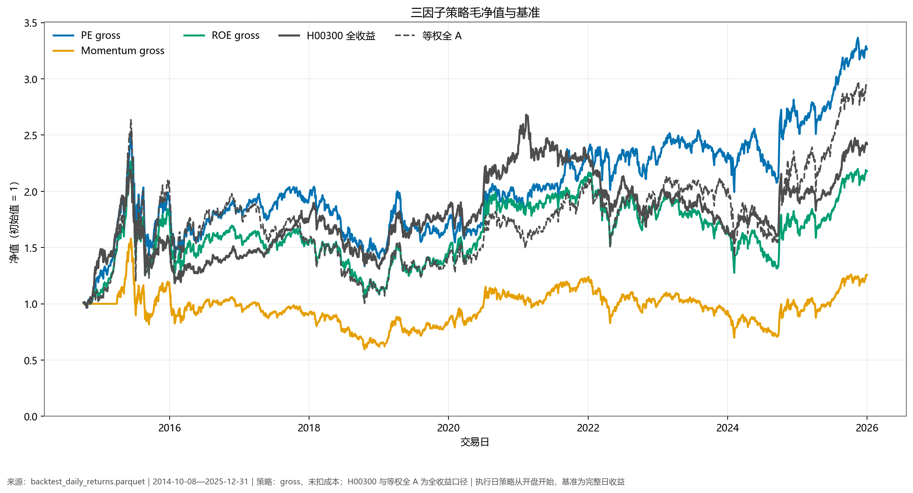

| 序列 | 口径 | 累计收益 | 年化收益 | 年化波动率 | 最大回撤 | Sharpe |
| --- | --- | ---: | ---: | ---: | ---: | ---: |
| PE | gross | 286.89% | 13.28% | 23.01% | -44.08% | 0.658 |
| PE | net 0 bp | 278.48% | 13.05% | 23.00% | -44.46% | 0.649 |
| PE | net 10 bp | 267.06% | 12.73% | 23.00% | -44.94% | 0.637 |
| PE | net 20 bp | 255.64% | 12.40% | 23.00% | -45.42% | 0.624 |
| Momentum | gross | 25.76% | 2.13% | 25.50% | -62.32% | 0.211 |
| Momentum | net 0 bp | 15.64% | 1.35% | 25.49% | -63.29% | 0.181 |
| Momentum | net 10 bp | 1.93% | 0.18% | 25.47% | -64.52% | 0.135 |
| Momentum | net 20 bp | -11.77% | -1.15% | 25.47% | -66.79% | 0.083 |
| ROE | gross | 117.99% | 7.44% | 24.13% | -53.71% | 0.419 |
| ROE | net 0 bp | 114.63% | 7.29% | 24.12% | -53.94% | 0.413 |
| ROE | net 10 bp | 110.06% | 7.08% | 24.12% | -54.23% | 0.405 |
| ROE | net 20 bp | 105.49% | 6.86% | 24.12% | -54.53% | 0.397 |
| H00300 | 全收益基准 | 141.94% | 8.48% | 21.80% | -46.06% | 0.483 |

PE 的毛收益、最大回撤和 Sharpe 在本样本中均好于 H00300。ROE 和 Momentum 的毛累计收益低于 H00300，最大回撤更深，Sharpe 也更低。策略与基准的首日收益起点并不完全一致：策略从执行日开盘开始，H00300 使用完整交易日收益，因此比较存在盘中时点差异。

## 交易成本与风险

佣金按实际成交金额双边各 3 bp 计算。印花税只在卖出时收取：2023-08-28 以前为 10 bp，之后为 5 bp。0 bp 只表示没有额外滑点，仍包含佣金和印花税；10 bp 和 20 bp 是买卖双边的滑点假设。

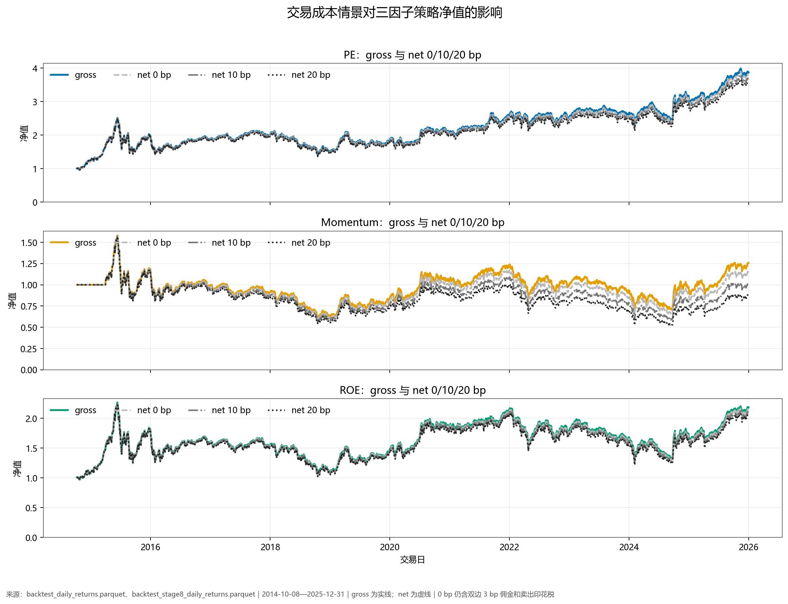

换手率表示组合买卖金额相对前一日毛净值的比例，数值越高，交易越频繁。累计成本是归一化组合上逐日扣除的 NAV 点数之和，不等于期末毛净值与净净值的简单差。

| 因子 | 年化换手率 | 0 bp 累计成本 | 10 bp 累计成本 | 20 bp 累计成本 |
| --- | ---: | ---: | ---: | ---: |
| PE | 272.65% | 4.64% | 11.02% | 17.40% |
| Momentum | 1007.41% | 7.79% | 18.36% | 28.92% |
| ROE | 193.92% | 2.49% | 5.86% | 9.22% |

Momentum 的年化换手率最高，成本情景间的净收益差也最大。ROE 的换手率和累计成本最低。这里的成本比例是 NAV 点数，不能解释为券商账单占初始资金的精确比例。

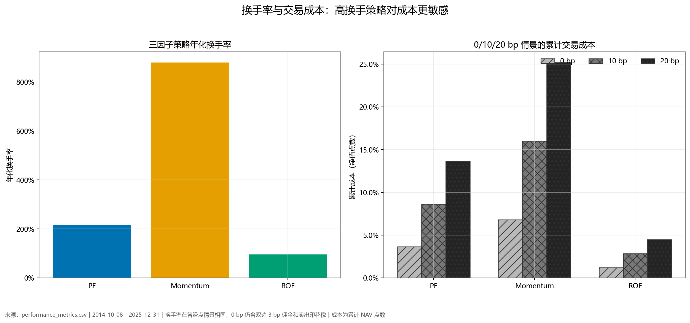

三个毛收益策略都经历过较深回撤。PE、Momentum、ROE 的最大回撤分别为 -44.08%、-62.32% 和 -53.71%。

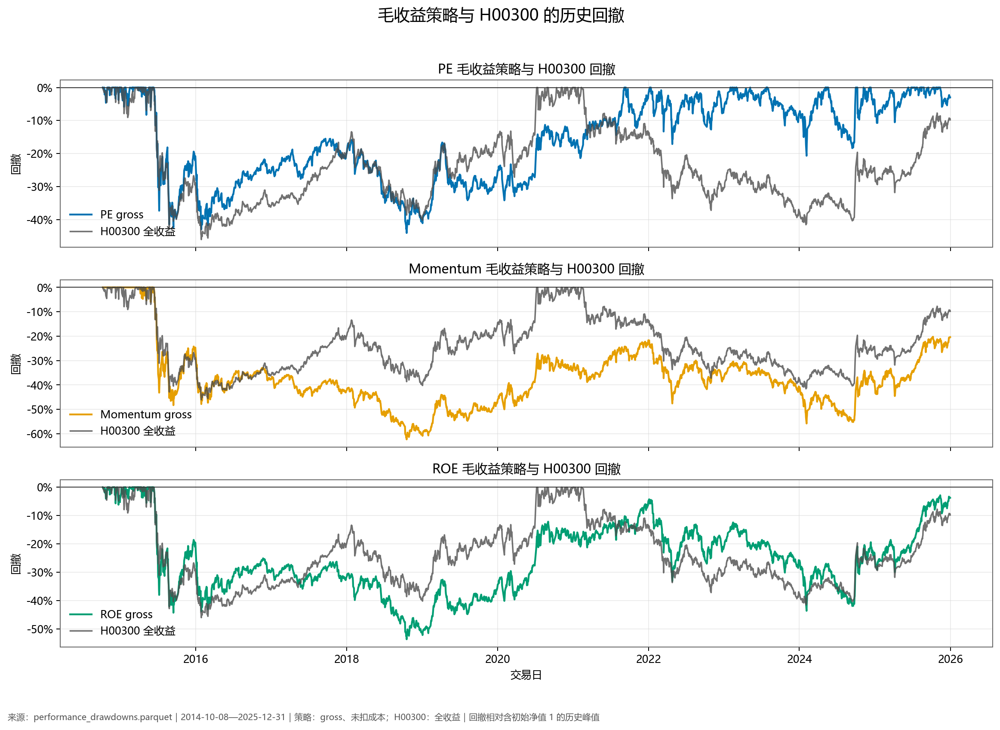

月度收益也有明显波动。135 个月中，PE 有 73 个上涨月，Momentum 有 62 个上涨月、67 个下跌月和 6 个零收益月，ROE 有 72 个上涨月。三个策略的最差月份均为 2016 年 1 月，收益分别为 -24.58%、-27.02% 和 -26.62%。

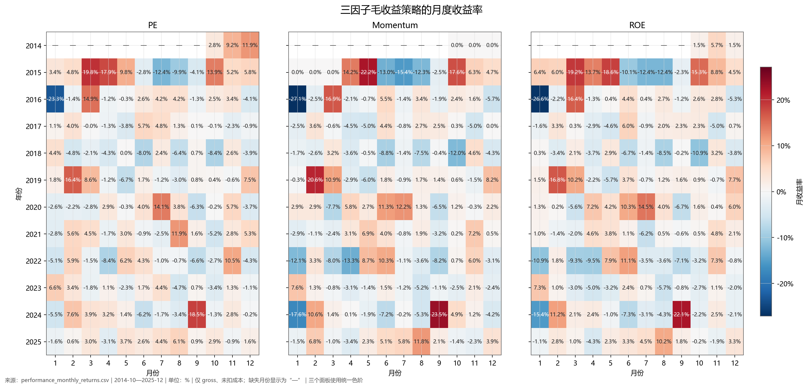

## 稳健性测试

阶段 10 固定检验 Top 10% / 20% / 30%、Monthly / Quarterly 和 0 / 10 / 20 bp，共 18 组参数；三个因子合计 54 个策略成本情景。Quarterly 使用 3、6、9、12 月的月末信号，并在下一交易日开盘执行。测试只描述敏感性，不据此重新选择参数。

| 因子 | 净累计收益范围 | 年化波动率范围 | 最大回撤范围 | Sharpe 范围 | 收益方向是否变化 |
| --- | ---: | ---: | ---: | ---: | --- |
| PE | 189.41%～278.48% | 22.08%～23.32% | -51.79%～-41.90% | 0.542～0.658 | 否 |
| Momentum | -16.37%～27.66% | 24.82%～25.57% | -66.86%～-61.22% | 0.061～0.217 | 是 |
| ROE | 62.43%～137.11% | 23.39%～24.47% | -56.93%～-53.12% | 0.309～0.448 | 否 |

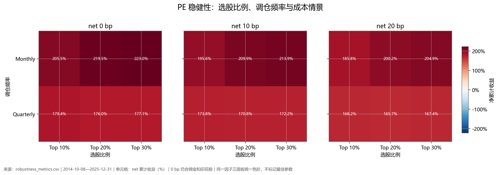

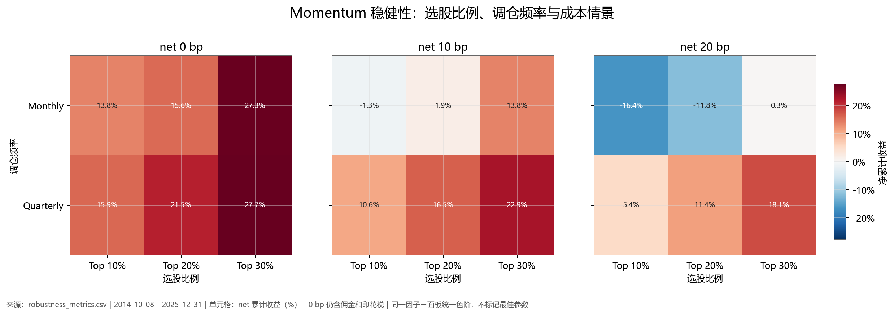

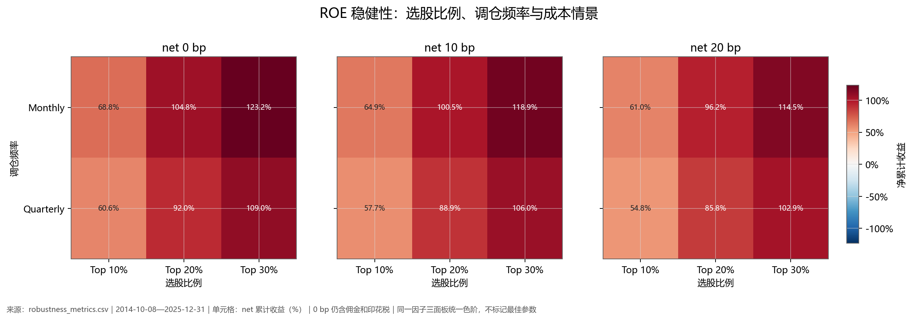

PE 和 ROE 在已测试网格内没有出现累计净收益正负反转，但结果水平会随选股比例、调仓频率和成本改变。Momentum 在 Top 10%、Monthly、10 bp，以及 Top 10% 或 Top 20%、Monthly、20 bp 三个情景下转为负收益；其他组合仍为正。该事实不构成参数推荐。

## 研究限制

- PE 按交易日 `PE1TTM` 直接可用处理。原始数据无法严格复核其 TTM 财务分母的披露时点、报表版本和历史股本生效时间，因此 PE 结果存在前视风险。
- ROE 只使用信号日前严格已披露的年度合并报表；历史股票池保留后来退市股票在此前符合条件的记录，以避免只研究期末存活股票。
- 策略执行日从开盘开始，H00300 使用完整日收益，盘中起点不完全一致。H00300 不适用策略换手率和交易成本。
- 日频数据不能可靠识别涨跌停拒单，也不能证明有正常状态和有效开盘价的订单一定可以成交。盘口深度、真实冲击成本和实际滑点未纳入。
- 缺少真实初始资金、股数和订单金额，最低佣金及整手约束未纳入。佣金和滑点是研究假设，不代表特定券商费率。
- 无法买入的资金按现金处理，现金收益为 0；未加入融资、借款或资金容量约束。2025-12-31 的信号没有后续执行日，不进入新的实际调仓。
- 因子检验、相关性和历史回测都不能证明因果关系。样本内收益也不能直接外推为未来收益。

## 结论

在既定样本和规则下，PE 的分组、Rank IC 和策略回测给出了方向较一致的结果，但其数据可用时点限制影响结论可信度。Momentum 的预设方向没有得到因子检验支持，且交易成本影响较大。ROE 策略获得正收益，但横截面检验证据较弱。

因此，这项研究能够回答三个因子在历史样本中的表现差异，也显示成本和参数会改变结果。它是一份可复核的历史研究，不是投资建议。
