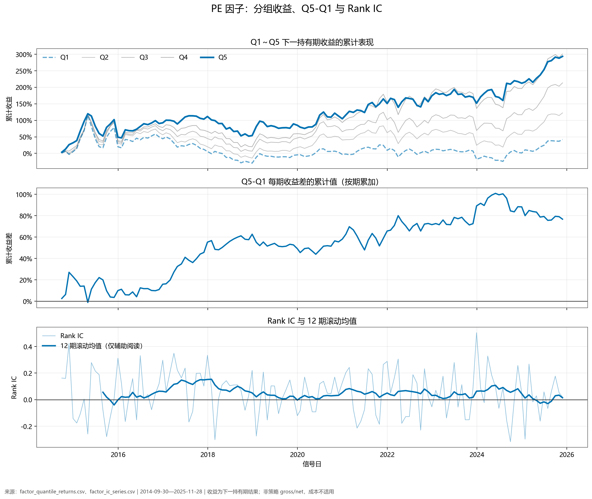
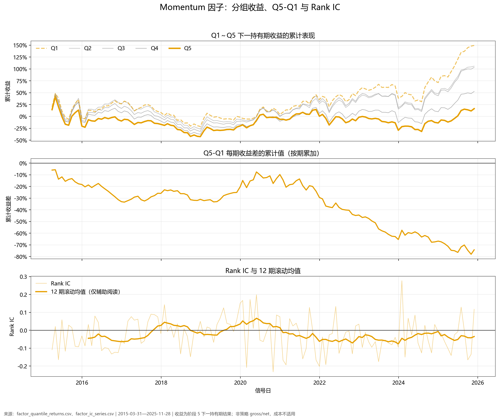
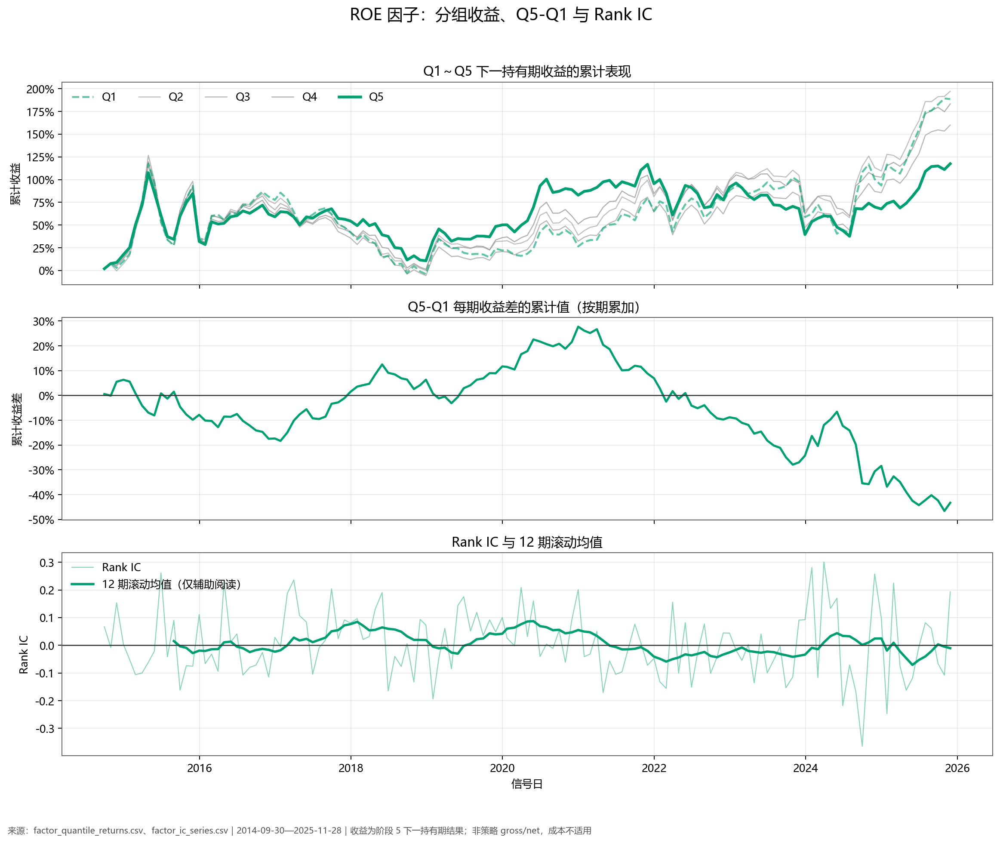
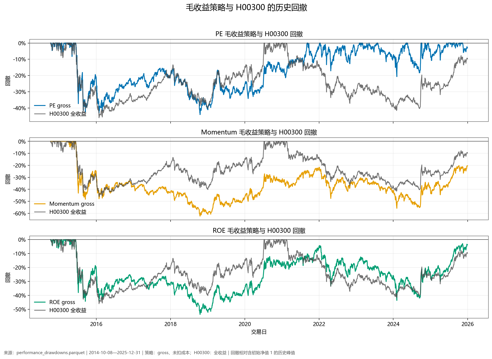
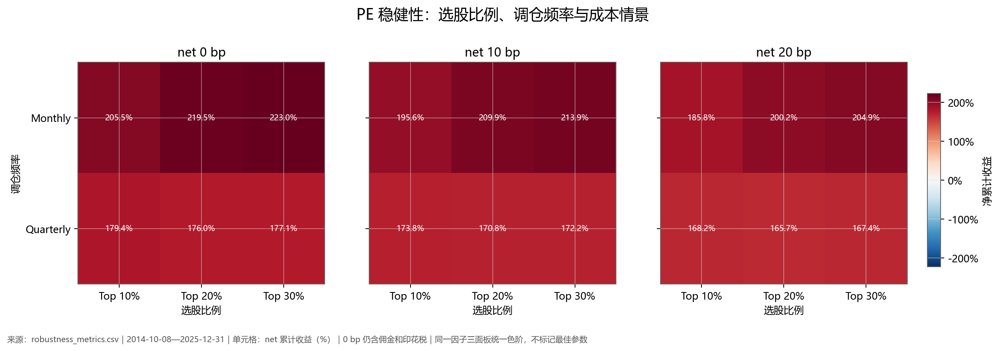

# A 股单因子研究：PE、Momentum、ROE（2014–2025）

## 摘要

样本 2014-09-12 至 2025-12-31，136 个月末信号日，2,735 个交易日；股票池按当时可得信息构建，平均每期 3,638 只。三个因子的结论如下：

| 因子 | 平均 Rank IC | IC 胜率 | 累计 Q5-Q1 | Top 20% 毛累计 | 基准 H00300 | 判断 |
| --- | ---: | ---: | ---: | ---: | ---: | --- |
| PE（低估值） | 0.0501 | 65.93% | 76.70% | 286.89% | 141.94% | 方向一致，但归因未分离 |
| Momentum（6M） | -0.0236 | 39.53% | -74.23% | 25.76% | 141.94% | 方向与预设相反 |
| ROE（质量） | 0.0065 | 48.89% | -43.26% | 117.99% | 141.94% | 横截面证据接近零 |

只有 PE 的三类证据方向一致。但组合是**全 A 等权买约 20%**，基准是**市值加权的沪深 300**，两者不是同一风险来源（见 5.1），因此 PE 的超额不能全部归因于估值因子。

## 1 数据与股票池

数据来自 CSMAR：日行情（`TRD_Dalyr`）、估值（`STK_MKT_ValuationMetrics`）、利润表与资产负债表（`FS_Comins` / `FS_Combas`）、实际披露日（`IAR_Forecdt`）、上市信息与状态变更（`STK_LISTEDCOINFOANL` / `STK_ITEMCHANGE`）、交易日历（`TRD_Cale`）、沪深 300 全收益（`IDX_Idxtrd`）。

股票池每月末构建一次，纳入条件：当日有交易记录且 `Trdsta=1`、首次上市满 6 个自然月、未处于暂停上市 / 退市整理期 / 终止上市。状态只按生效日在信号日或之前的事件判断，不用期末存活名单反推；后来退市的 231 只在退市前仍留在池中，这是股票池不产生幸存者偏差的关键。每期 2,060–4,938 只。

## 2 因子定义

- **PE**：信号日 `PE1TTM` 为正值者参与排名，越低分数越高。非正值与缺失不参与排名，正值极端值不截尾。
- **Momentum**：用含现金红利再投资的 `Adjprcwd`，取不晚于 6 个自然月前最近有效交易日的收盘价，计算区间收益，越高分数越高。不跳过最近一个月。
- **ROE**：取信号日**之前**已实际披露的最新合并年报，净利润 ÷ 期末股东权益；权益须为正，净利润允许为负。

每个因子独立保留可排名样本，不强制三者取交集。每期每条记录都留有不可排名原因（缺失、非正、无历史价格、无已披露年报等）。

## 3 检验方法

每个信号日按因子分数分五组（Q1 最低、Q5 最高），组内等权。未来收益从**下一交易日**起算，到下一个月末信号日收盘，按 `Dretwd` 逐日复利。Rank IC 为因子分数与未来收益的 Spearman 相关系数；IC 胜率为有效月份中 IC > 0 的比例。

需要区分两种累计口径：Q1–Q5 的“累计收益”是各期收益的**复利**；Q5-Q1 的累计值是每期组间差值的**算术累加**，不是可投资的净值，两者不可互相印证。

## 4 结果

### 4.1 因子检验

| 因子 | Q1 | Q2 | Q3 | Q4 | Q5 | 累计 Q5-Q1 | 平均 Rank IC | IC 胜率 |
| --- | ---: | ---: | ---: | ---: | ---: | ---: | ---: | ---: |
| PE | 41.84% | 122.56% | 213.48% | 300.69% | 293.65% | 76.70% | 0.0501 | 65.93% |
| Momentum | 149.40% | 105.84% | 103.31% | 52.63% | 16.41% | -74.23% | -0.0236 | 39.53% |
| ROE | 188.56% | 197.16% | 160.01% | 183.28% | 117.47% | -43.26% | 0.0065 | 48.89% |

PE 的 Q5 高于 Q1，但 **Q4 高于 Q5**，不是单调关系。Momentum 的排序方向与预设相反。ROE 各组没有形成递增序列。

### 4.2 组合回测

月末选分数最高的约 20% 等权持有，下一交易日开盘执行，无法买入的权重留作现金，无法卖出的持仓在恢复交易后卖出。

| 序列 | 累计收益 | 年化收益 | 年化波动率 | 最大回撤 | Sharpe |
| --- | ---: | ---: | ---: | ---: | ---: |
| PE gross | 286.89% | 13.28% | 23.01% | -44.08% | 0.658 |
| PE net 20bp | 255.64% | 12.40% | 23.00% | -45.42% | 0.624 |
| Momentum gross | 25.76% | 2.13% | 25.50% | -62.32% | 0.211 |
| Momentum net 20bp | -11.77% | -1.15% | 25.47% | -66.79% | 0.083 |
| ROE gross | 117.99% | 7.44% | 24.13% | -53.71% | 0.419 |
| ROE net 20bp | 105.49% | 6.86% | 24.12% | -54.53% | 0.397 |
| H00300 | 141.94% | 8.48% | 21.80% | -46.06% | 0.483 |

三个毛收益策略的回撤都很深；Momentum 的 Sharpe 低于基准且扣除成本后为负。

### 4.3 成本与换手

佣金买卖双边各 3 bp；印花税卖出时收取，2023-08-28 前 10 bp、之后 5 bp；滑点设 0/10/20 bp（0 bp 仍含佣金与印花税）。成本只对实际成交计提。

| 因子 | 年化换手率 | 0 bp 累计成本 | 10 bp | 20 bp |
| --- | ---: | ---: | ---: | ---: |
| PE | 272.65% | 4.64% | 11.02% | 17.40% |
| Momentum | 1007.41% | 7.79% | 18.36% | 28.92% |
| ROE | 193.92% | 2.49% | 5.86% | 9.22% |

Momentum 的换手超过 10 倍净值/年，是它在高成本情景下转为负收益的直接原因。

### 4.4 稳健性

固定 Top 10% / 20% / 30%、月度 / 季度、0 / 10 / 20 bp，三个因子合计 54 个情景。

| 因子 | 净累计收益范围 | 年化波动率 | 最大回撤 | Sharpe | 方向是否反转 |
| --- | ---: | ---: | ---: | ---: | --- |
| PE | 189.41%～278.48% | 22.08%～23.32% | -51.79%～-41.90% | 0.542～0.658 | 否 |
| Momentum | -16.37%～27.66% | 24.82%～25.57% | -66.86%～-61.22% | 0.061～0.217 | 是 |
| ROE | 62.43%～137.11% | 23.39%～24.47% | -56.93%～-53.12% | 0.309～0.448 | 否 |

网格只描述敏感性，不据此挑选参数。

## 5 局限

**5.1 超额未做归因。** 组合是全 A 等权，基准是市值加权的沪深 300，两者的市值、行业与权重结构都不同。同一张分位表里，**Q3（不做任何筛选）累计 213.48%，Q4 累计 300.69%，都高于 Q5 的 293.65%，且都高于基准的 141.94%**——这说明等权持有股票池本身就跑赢了市值加权基准，PE 的超额里含有相当比例的等权 / 小市值暴露。本项目没有做行业与市值中性化，也没有对基准做等权重构，因此不能声称 4.8 个百分点的年化超额来自估值因子。

**5.2 只有点估计，没有统计推断。** IC 均值、IC 胜率、组间差都只报告了点值，没有 IC 的标准差与 ICIR、没有 t 值、没有 Newey-West 修正、没有多空组合的显著性检验，也没有分年度或分子区间的稳定性。0.0501 的 IC 是否显著、在哪些年份失效，这份报告回答不了。

**5.3 PE 的时点假设。** `PE1TTM` 按交易日可用处理，原始数据无法复核其 TTM 分母的报表版本与披露时点，也未按历史股本还原。PE 的结论因此不能表述为已严格消除前视偏差；ROE 已按实际披露日严格处理，两者证据强度不同。

**5.4 股票池细节。** 未过滤 ST / *ST（A 股 5% 涨跌幅、退市风险、壳价值会污染低估值分组）；次新股门槛为 6 个月（业内常用 12 个月）；|日收益| > 100% 的记录只计数、未做 winsorize 或剔除敏感性。

**5.5 执行与成本。** 涨跌停、整手、最低 5 元佣金、盘口深度与资金容量均未建模；正常状态 + 有效开盘价不等于必然成交；现金收益为 0；H00300 用完整日收益而策略从开盘起算，首日盘中起点不一致。

**5.6 年化口径。** 按 252 个交易日年化（A 股近年年均约 243 天），年化收益略偏高；无风险利率取 0，Sharpe 分子用日算术均值、表中年化收益用几何复利，两个口径并列时数值不可直接相除。

## 6 结论

在 2014–2025 的样本内，PE 的分组、IC 与回测方向一致，但横截面不单调、超额未与等权/市值暴露分离，只能算“存在弱方向性”；Momentum 在 A 股这一区间失效且成本敏感；ROE 的横截面区分度接近零。三者的历史表现都不足以支撑可交易结论。

## 复现

原始数据需自行从 CSMAR 导出至 `项目初始数据/`（不入库）。依次执行 `python run.py clean universe factors evaluate portfolio backtest costs performance robustness figures`，或 `python run.py all`。各步骤的审计报告写入 `reports/generated/`（不入库），本文件与图表为定稿产物。
