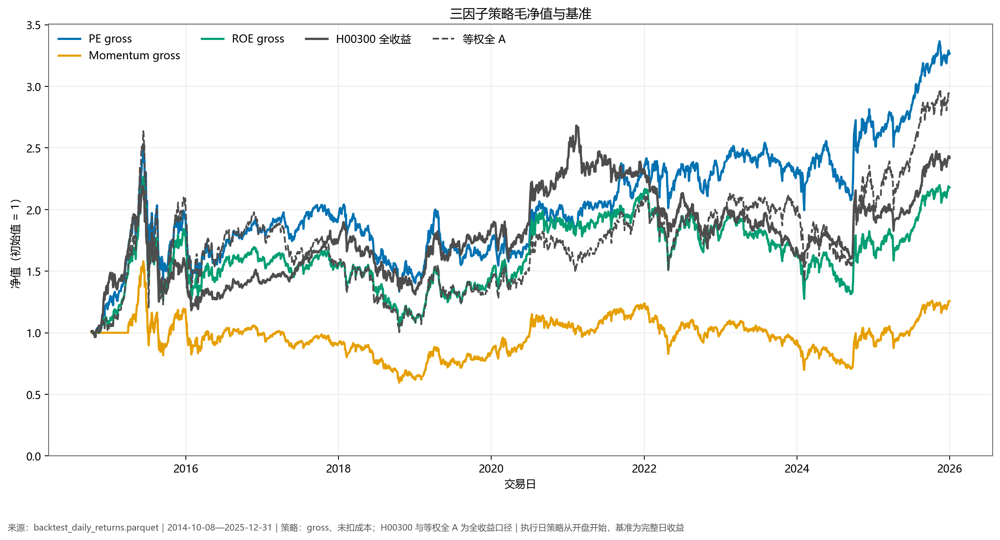
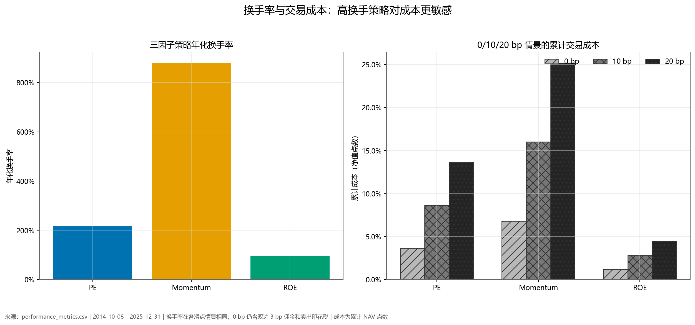

# A 股单因子研究：PE、Momentum、ROE（2014–2025）

## 摘要

样本 2014-09-12 至 2025-12-31，136 个月末信号日，2,735 个交易日；股票池按当时可得信息构建，平均每期 3,638 只。三个因子的结论如下：

| 因子 | 平均 Rank IC | IC 胜率 | 累计 Q5-Q1 | Top 20% 毛累计 | 基准 H00300 | 判断 |
| --- | ---: | ---: | ---: | ---: | ---: | --- |
| PE（低估值） | 0.0501 | 65.93% | 76.70% | 286.89% | 141.94% | 方向一致，中性化后更强 |
| Momentum（6M） | -0.0236 | 39.53% | -74.23% | 25.76% | 141.94% | 方向与预设相反 |
| ROE（质量） | 0.0065 | 48.89% | -43.26% | 117.99% | 141.94% | 弱，中性化后才显著 |

只有 PE 的三类证据方向一致。但组合是**全 A 等权买约 20%**，基准是**市值加权的沪深 300**，两者不是同一风险来源（见 5.1）。用等权全 A 做基准，PE 的年化超额从 4.80 个百分点降到 2.84 个百分点；再对行业与市值做中性化，PE 的 IC 反而从 0.0501 升到 0.0579，ICIR 从 0.30 升到 0.60。

## 1 数据与股票池

数据来自 CSMAR：日行情（`TRD_Dalyr`）、估值（`STK_MKT_ValuationMetrics`）、利润表与资产负债表（`FS_Comins` / `FS_Combas`）、实际披露日（`IAR_Forecdt`）、上市信息与状态变更（`STK_LISTEDCOINFOANL` / `STK_ITEMCHANGE`）、股本变动（`STK_CAPITAL`）、行业分类（`STK_INDUSTRYCLASS`）、交易日历（`TRD_Cale`）、沪深 300 全收益（`IDX_Idxtrd`）。

股票池每月末构建一次，纳入条件：当日有交易记录且 `Trdsta=1`、首次上市满 6 个自然月、未处于暂停上市 / 退市整理期 / 终止上市。`Trdsta` 的 2/3 即 ST/*ST，因此 ST 股在信号日本身就不入池，不需要额外过滤。状态只按生效日在信号日或之前的事件判断，不用期末存活名单反推；后来退市的 231 只在退市前仍留在池中，这是股票池不产生幸存者偏差的关键。每期 2,060–4,938 只。

市值由股本变动表的**总股数**乘当日收盘价得到，覆盖股票池 97.3% 的记录；行业取证监会 2012 版（P0207），按实施日开始日逐月对齐，覆盖 99.98%。

## 2 因子定义

- **PE**：信号日 `PE1TTM` 为正值者参与排名，越低分数越高。非正值与缺失不参与排名，正值极端值不截尾。
- **Momentum**：用含现金红利再投资的 `Adjprcwd`，取不晚于 6 个自然月前最近有效交易日的收盘价，计算区间收益，越高分数越高。不跳过最近一个月。
- **ROE**：取信号日**之前**已实际披露的最新合并年报，净利润 ÷ 期末股东权益；权益须为正，净利润允许为负。

每个因子独立保留可排名样本，不强制三者取交集。每期每条记录都留有不可排名原因。

## 3 检验方法

每个信号日按因子分数分五组（Q1 最低、Q5 最高），组内等权。未来收益从**下一交易日**起算，到下一个月末信号日收盘，按 `Dretwd` 逐日复利。Rank IC 为因子分数与未来收益的 Spearman 相关系数；IC 胜率为有效月份中 IC > 0 的比例。

**中性化**：在每个信号日的横截面上，把因子分数先转成 z 值，对 `log(市值)` 与证监会行业哑变量做 OLS，取残差后重新排名。行业内股票数少于 20 只的合并为 `OTHER`。中性化的样本要求同时有分数、市值与行业，因此比原始样本小；为此额外计算一列"同子样本原始 IC"，在同一批股票上重算原始分数，用来把"中性化本身的效应"和"样本变化"分开。

**统计量**：IC 的均值、标准差、ICIR（均值/标准差）、t 值（ICIR × √期数），以及 Q5−Q1 月均差与 t 值。

## 4 结果

### 4.1 因子检验（原始分数）

| 因子 | Q1 | Q2 | Q3 | Q4 | Q5 | 累计 Q5-Q1 | 平均 Rank IC | IC 胜率 |
| --- | ---: | ---: | ---: | ---: | ---: | ---: | ---: | ---: |
| PE | 41.84% | 122.56% | 213.48% | 300.69% | 293.65% | 76.70% | 0.0501 | 65.93% |
| Momentum | 149.40% | 105.84% | 103.31% | 52.63% | 16.41% | -74.23% | -0.0236 | 39.53% |
| ROE | 188.56% | 197.16% | 160.01% | 183.28% | 117.47% | -43.26% | 0.0065 | 48.89% |


PE 的 Q5 高于 Q1，但 **Q4 高于 Q5**，不是单调关系。Momentum 的排序方向与预设相反。ROE 各组没有形成递增序列。

### 4.2 中性化前后

| 因子 | 原始 IC | 同子样本原始 IC | 中性化 IC | t（原始） | t（中性） | ICIR（原始） | ICIR（中性） |
| --- | ---: | ---: | ---: | ---: | ---: | ---: | ---: |
| PE | 0.0501 | 0.0501 | **0.0579** | 3.51 | **6.92** | 0.30 | **0.60** |
| Momentum | -0.0236 | -0.0239 | -0.0121 | -2.83 | -2.77 | -0.25 | -0.24 |
| ROE | 0.0065 | 0.0064 | 0.0153 | 0.64 | 2.11 | 0.05 | 0.18 |


同子样本列与原始列几乎相同，说明样本变化不是原因。中性化之后：

- **PE 的 IC 上升、波动下降**：IC 均值 0.0501 → 0.0579，标准差 0.166 → 0.097，ICIR 翻倍，Q5−Q1 月均差从 0.57% 升到 0.99%（t 从 1.30 升到 4.30）。原始分数与 `log(市值)` 的月度 Spearman 相关均值是 0.28，残差化后降到 0.04（绝对值最大 0.08）。也就是说，PE 的低估值信号在剔除"低 PE 多为小盘股"的成分后**更干净**，而不是被小市值撑起来的。
- **Momentum 依旧为负**：-0.0236 → -0.0121，t 值 -2.77，方向没有改变。
- **ROE 从"看不出"变成"弱显著"**：0.0065（t 0.64）→ 0.0153（t 2.11）。原始 ROE 分数带有行业差异（银行、公用事业天然高 ROE），剥掉之后信号才浮现。

### 4.3 组合回测

月末选分数最高的约 20% 等权持有，下一交易日开盘执行，无法买入的权重留作现金，无法卖出的持仓在恢复交易后卖出。

| 序列 | 累计收益 | 年化收益 | 年化波动率 | 最大回撤 | Sharpe |
| --- | ---: | ---: | ---: | ---: | ---: |
| PE gross | 286.89% | 13.28% | 23.01% | -44.08% | 0.658 |
| Momentum gross | 25.76% | 2.13% | 25.50% | -62.32% | 0.211 |
| ROE gross | 117.99% | 7.44% | 24.13% | -53.71% | 0.419 |
| H00300（市值加权，300 只） | 141.94% | 8.48% | 21.80% | -46.06% | 0.483 |
| 等权全 A | 193.90% | 10.44% | 29.43% | -61.91% | 0.486 |
| 市值加权全 A | 143.30% | 8.54% | 22.61% | -48.43% | 0.476 |




### 4.4 成本与换手

佣金买卖双边各 3 bp；印花税卖出时收取，2023-08-28 前 10 bp、之后 5 bp；滑点设 0/10/20 bp（0 bp 仍含佣金与印花税）。成本只对实际成交计提。

| 因子 | 年化换手率 | 0 bp 累计成本 | 10 bp | 20 bp |
| --- | ---: | ---: | ---: | ---: |
| PE | 272.65% | 4.64% | 11.02% | 17.40% |
| Momentum | 1007.41% | 7.79% | 18.36% | 28.92% |
| ROE | 193.92% | 2.49% | 5.86% | 9.22% |



Momentum 的换手超过 10 倍净值/年，是它在高成本情景下转为负收益的直接原因。

### 4.5 稳健性

固定 Top 10% / 20% / 30%、月度 / 季度、0 / 10 / 20 bp，三个因子合计 54 个情景。

| 因子 | 净累计收益范围 | 年化波动率 | 最大回撤 | Sharpe | 方向是否反转 |
| --- | ---: | ---: | ---: | ---: | --- |
| PE | 189.41%～278.48% | 22.08%～23.32% | -51.79%～-41.90% | 0.542～0.658 | 否 |
| Momentum | -16.37%～27.66% | 24.82%～25.57% | -66.86%～-61.22% | 0.061～0.217 | 是 |
| ROE | 62.43%～137.11% | 23.39%～24.47% | -56.93%～-53.12% | 0.309～0.448 | 否 |


网格只描述敏感性，不据此挑选参数。

## 5 局限

**5.1 超额的两个来源。** 组合是全 A 等权，基准是市值加权的沪深 300。把同样的股票池等权持有，年化 10.44%；市值加权 8.54%；HS300 8.48%。所以 PE 相对 HS300 的 4.80 个百分点里，约 **1.96 个百分点只是等权/小市值暴露**，因子本身约 **2.84 个百分点**。市值加权全 A 与 HS300 几乎重合（8.54% vs 8.48%），说明差距不是"全 A vs 300 只"，而是"等权 vs 市值加权"。组合的 Sharpe（0.658）高于等权全 A（0.486），但等权基准的波动率（29.4%）也远高于组合（23.0%）。

**5.2 统计量仍是单样本。** 现在给出了 IC 的 t 值、ICIR 与 Q5−Q1 的 t 值，但仍是 2014–2025 一个样本、事后选定三个因子，没有样本外区间，也没有多重检验修正。t 值高不代表在别的样本里成立。

**5.3 PE 的时点假设。** `PE1TTM` 按交易日可用处理，原始数据无法复核其 TTM 分母的报表版本与披露时点，也未按历史股本还原。PE 的结论因此不能表述为已严格消除前视偏差；ROE 已按实际披露日严格处理，两者证据强度不同。

**5.4 股票池与样本细节。** 信号日按 `Trdsta=1` 已排除 ST/*ST，但**持仓期内**转为 ST 或长期停牌的不做单独处理，只在无法交易时冻结估值（全样本 13.6 万条持仓日被冻结）。次新股门槛为 6 个自然月（业内常用 12 个月）；|日收益| > 100% 的记录只计数、未做 winsorize。

**5.5 中性化的口径。** 市值用"总股本 × 当日收盘价"，总股本来自股本变动表，与 CSMAR `PE1TTM` 的股本口径一致，但未做自由流通市值调整；行业用的是证监会 2012 版大类，按实施日逐月对齐，分类本身的历史调整可能滞后于实际经营变化。中性化样本比原始样本小（PE 平均每期 2,897 只 vs 可排名 2,982 只），所以每张表都并列给出同子样本的原始 IC。

**5.6 执行与成本。** 涨跌停、整手、最低 5 元佣金、盘口深度与资金容量均未建模；正常状态 + 有效开盘价不等于必然成交；现金收益为 0；H00300 用完整日收益而策略从开盘起算，首日盘中起点不一致。

**5.7 年化口径。** 按 252 个交易日年化（A 股近年年均约 243 天），年化收益略偏高；无风险利率取 0，Sharpe 分子用日算术均值、表中年化收益为几何复利，两个口径并列时数值不可直接相除。

## 6 结论

在 2014–2025 的样本内，PE 的分组、IC 与回测方向一致；剔除行业与市值暴露后 IC 从 0.0501 升到 0.0579、ICIR 翻倍，说明它的选股能力不是小市值或行业轮动的伪装。但它的超额比看上去小：相对等权全 A 只有 2.84 个百分点/年，而不是相对 HS300 的 4.80。Momentum 在这一区间失效且成本敏感，ROE 只有在中性化后才勉强显著。三者都不足以支撑可交易结论。

## 复现

原始数据需自行从 CSMAR 导出至 `项目初始数据/`（不入库）。依次执行

```bash
python run.py clean universe marketcap factors evaluate portfolio backtest costs performance robustness figures
```

或 `python run.py all`。各步骤的审计报告写入 `reports/generated/`（不入库），本文件与图表为定稿产物。
